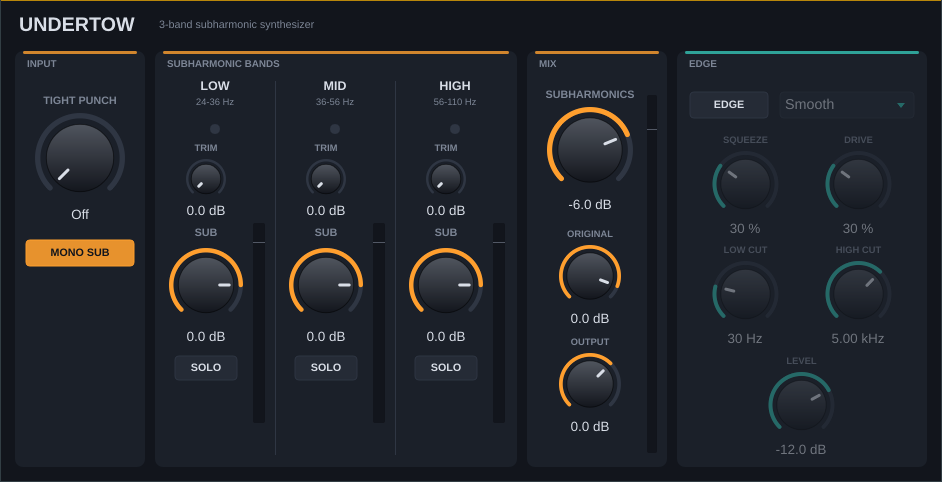

# Undertow — 3-band subharmonic synthesizer

An original plugin that recreates the *workflow and behaviour* of a dbx 120-style subharmonic
synthesizer with a third "high bass" band (the concept behind Brainworx bx_subsynth).
It generates **new bass one octave below** what you feed it — not an EQ boost.

Formats: **VST3** (Windows + Mac), **AU** (Mac), plus a Standalone app.
Works in **Adobe Audition** and **Ableton Live**.



---

## Controls

**Global**

| Control | What it does |
|---|---|
| **Synthesis Input** | *Mid*: subs are made from L+R and stay dead-centre (recommended). *Stereo*: separate subs per side. |
| **Gain In / Gain Out** | Input and output level. |
| **Mix** | Blend between the untouched input (0%) and the fully processed signal (100%). |
| **Mono Maker** | Everything below this frequency is made mono (Off–500 Hz). Keeps the low end tight on club systems. |
| **Stereo Width** | 0% = mono, 100% = unchanged, 200% = extra wide. |
| **Input meters** | L/R input level. |

**Sub**

| Control | What it does |
|---|---|
| **Subharmonics** | Master level of all generated subs. |
| **Band knobs** (24–36, 36–56, 56–110 Hz) | Level of the sub landing in each range. Meter under each shows its output. |
| **Trim** (small knob) | 0 to +18 dB boost into that band's input region. Use on quiet sources so the tracker locks on. |
| **Solo** | Hear only that band's sub (the original is muted). Solo all three to hear just the subs. |
| **LED** next to each range | Lights when there's material in that range to fold down. Boost bands whose LED is lit. |
| **Sub Out scope** | Live view of the generated sub. |

The window can be resized by dragging its bottom-right corner (70%–160%); it remembers the size.

**Edge** (power button top-right)

| Control | What it does |
|---|---|
| **Mode** | *Smooth*: tube-like saturation. *Harsh*: asymmetric clipping, trashier. |
| **Squeeze** | Compression amount. |
| **Drive** | Saturation depth (auto level-compensated). |
| **Low / High Cut** | Band-limit what goes into the Edge path. |
| **Edge Level** | How much Edge is blended in (parallel). |
| **Tight Punch** | Resonant high-pass (Off–250 Hz) before synthesis: tames boomy existing lows, adds punch. |
| **Low End** | ±12 dB low shelf (100 Hz) on the original signal. |
| **Output meters** | L/R output level. |

**Band map** (note being played → generated sub):

- 48–72 Hz → **24–36 Hz**
- 72–112 Hz → **36–56 Hz**
- 112–220 Hz → **56–110 Hz** (good for snares, toms, guitars, male vocals)

### Quick setup
1. Set **Tight Punch** just below the lowest note you care about.
2. Watch the LEDs; raise the band knobs whose LED lights. Use **Solo** to audition each.
3. If the sub breaks up on a quiet source, raise that band's **Trim**.
4. Blend with **Subharmonics**. Check on headphones or a sub — 24–36 Hz is inaudible on laptop speakers.
5. Optional: switch on **Edge** for grit and density.

---

## How the synthesis works

A single tracker follows the *fundamental* of the bass region (48–220 Hz). It triggers once
per input cycle, using a low-pass-tilted copy of the signal so harmonics can't cause extra
triggers, with hysteresis and a minimum-period lockout to reject noise. Each trigger starts a
new half-sine arc lasting one input period with alternating polarity, which produces a **clean
sine at exactly half the frequency**. Its loudness follows the input's envelope and a gate
silences it below about -74 dBFS. The sub is then split into the three output bands with
Linkwitz-Riley crossovers, which sum back flat. The tracker also listens down to 25 Hz so very low
notes are recognised correctly; notes below about 46 Hz (whose sub would be under 23 Hz and
inaudible) fade the sub out instead of producing a wrong-pitch tone.

Because the sub is a sine at f/2, it never lands on the original note or its harmonics, so it
adds low end without cancelling anything that's already there.

Measured (48 kHz, `tests/engine_test.cpp` and a synthetic drum+bass loop): output within about
±3 dB across 64–200 Hz input, sub level roughly equal to the note it comes from, and
non-harmonic by-products about 40 dB below the sub.

All DSP lives in `Source/SubEngine.h` (no JUCE dependency) if you want to tweak it.

---

## Installing on a Mac (one command)

Quit your DAW, open Terminal and paste:

```
curl -fsSL https://raw.githubusercontent.com/JSZMoney/Undertow.Public/main/install-mac.sh | bash
```

It downloads the newest build, puts `Undertow.vst3` and `Undertow.component` in
`~/Library/Audio/Plug-Ins/`, and clears the download-quarantine flag on just those two files.
Run the same command again to update. Then rescan:

- **Ableton Live:** Settings → Plug-Ins → *Use VST3 Plug-In System Folders* and *Use Audio Units* on → **Rescan**.
- **Adobe Audition:** Effects → **Audio Plug-In Manager…** → **Scan for Plug-Ins** → enable Undertow.

To uninstall, delete those two files.

## How builds happen

Every push to `main` builds Windows and Mac versions on GitHub (`.github/workflows/build.yml`)
and publishes them as the **latest** release, so the download link above always points at the
newest build. Windows users can grab `Undertow-Windows-plugins.zip` from the Releases page and
copy `Undertow.vst3` into `C:\Program Files\Common Files\VST3\`.

### Building locally instead
You need CMake 3.22+ and Xcode Command Line Tools (Mac) or Visual Studio 2022 (Windows);
JUCE is downloaded automatically.
```
cmake -S . -B build
cmake --build build --config Release
```
Results land in `build/Undertow_artefacts/Release/`.

---

## Running the DSP test
```
cd tests
g++ -O2 -std=c++17 -I../Source engine_test.cpp -o engine_test && ./engine_test
```

## Legal
Undertow is an independent implementation. It contains no code, artwork or assets from Brainworx,
Plugin Alliance or dbx; product names are mentioned only to describe the style of processing.
VST is a trademark of Steinberg. JUCE is used under its own licence (AGPLv3, or JUCE's free Starter / paid licences if you distribute closed-source — personal use is fine; see juce.com/legal).
